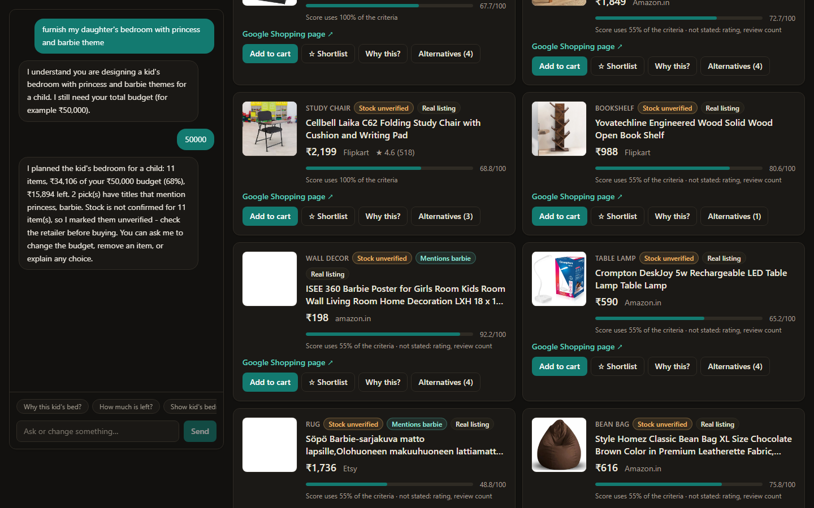
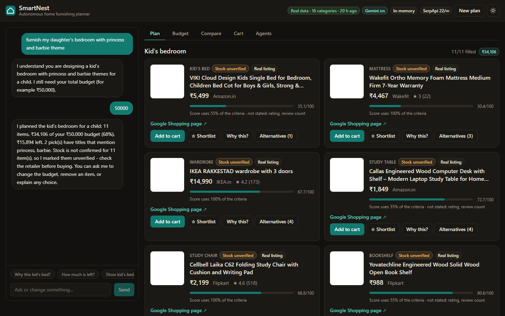
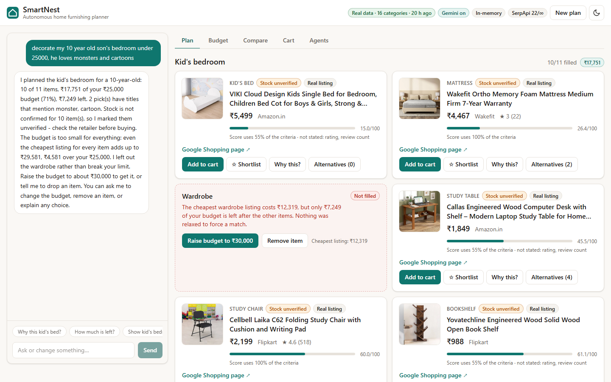
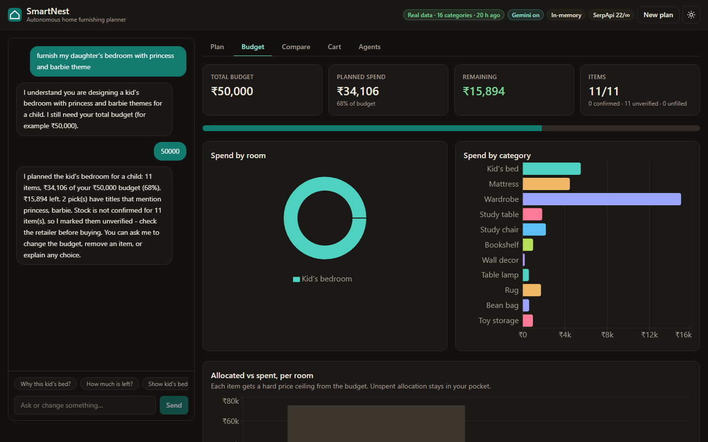
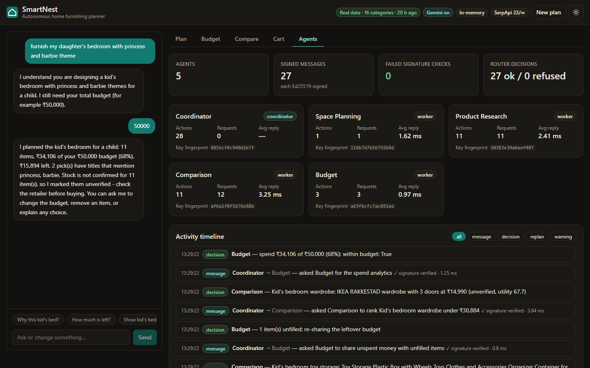
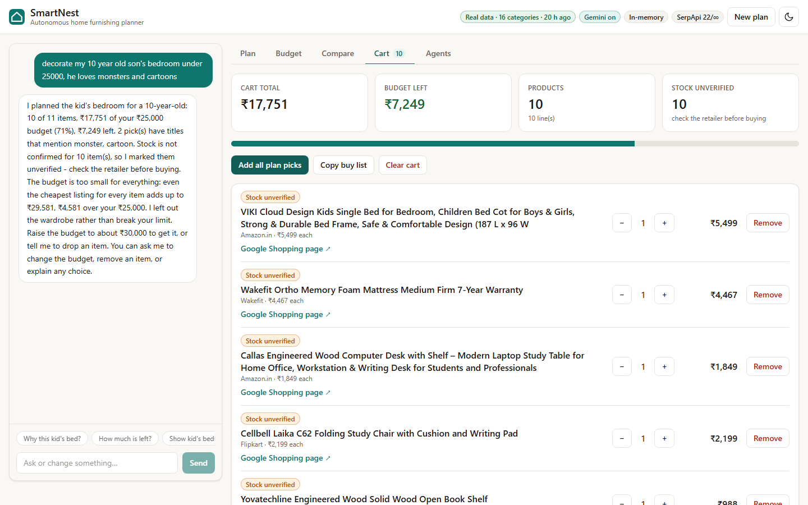
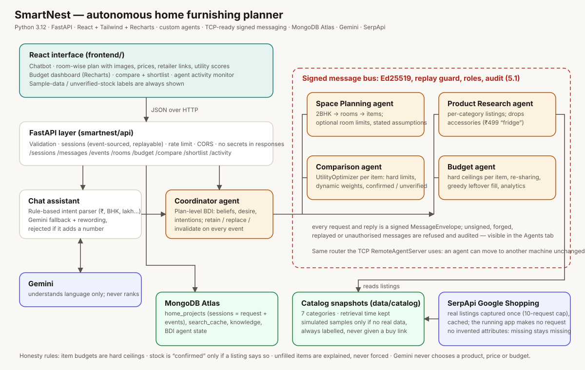
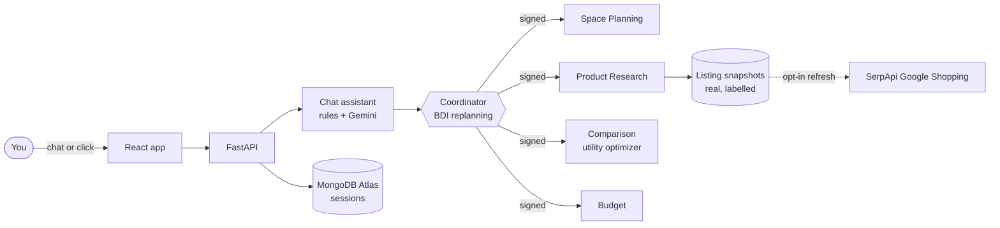

<div align="center">

# 🏠 SmartNest

### Tell it what to furnish. It plans every room with real products, honest scores, and a budget it will never break.




</div>

---

## ⚡ The 10-second pitch

You type: **"furnish my daughter's bedroom with princess and barbie theme, budget 50000."**

SmartNest understands the *room*, the *child*, the *theme* and the *budget*, sends a team of agents to work, and comes back with
**11 real products, with prices, images and links, for ₹34,106 out of ₹50,000**: a Barbie poster, a Barbie rug, a bed, a desk,
a wardrobe, and more. Every pick says **how** it was chosen, **what the listing didn't tell us**, and whether the stock is
confirmed. If your budget is too small for everything, it tells you the exact number that would fit, instead of quietly cheating.

It is a chatbot that doesn't make things up. It is a planner that shows its work.

---

## 🎬 See it work

<table>
<tr>
<td width="50%"><br><sub><b>One message, a whole room.</b> Real listings, a score for each pick, and the honest "stock unverified" label where a listing doesn't say.</sub></td>
<td width="50%"><br><sub><b>Budget too small? It says exactly why.</b> The cheapest wardrobe is ₹12,319 and only ₹7,249 is left. One click raises the budget to the number that fits.</sub></td>
</tr>
<tr>
<td><br><sub><b>Budget dashboard.</b> Where every rupee goes: by room, by category, allocated versus spent.</sub></td>
<td><br><sub><b>Agent activity monitor.</b> Every message between the agents is Ed25519-signed and verified before anyone acts on it.</sub></td>
</tr>
<tr>
<td colspan="2"><br><sub><b>Cart.</b> A buy list with a running total that can never go over your budget, and links straight to the seller. SmartNest sells nothing; you buy where it's cheapest.</sub></td>
</tr>
</table>

<sub>A 3-minute walkthrough script is in [docs/DEMO_SCRIPT.md](docs/DEMO_SCRIPT.md); `node e2e/record-demo.mjs` (in `frontend/`) records it.</sub>

---

## 🛡️ Rules it never breaks

Most "AI shopping" demos look great until you check the prices. SmartNest is built the other way round:

| Rule | What it means in practice |
|---|---|
| **The budget is a hard wall** | Every item gets a price ceiling and the optimizer cannot pick above it, so the plan total can't exceed your budget. Tested as a property across many budgets, on real and sample data. |
| **No invented product facts** | A missing rating, size, colour or style stays *missing* and is shown as "not stated". Nothing is defaulted or guessed. |
| **Stock is "confirmed" only if the listing says so** | Everything else is labelled *unverified*, and still counts against your budget. |
| **A leftover is never wasted, a shortfall is never hidden** | If something doesn't fit, SmartNest re-splits the budget; if it truly can't fit, it names the cheapest total and offers to raise the budget or drop the item. |
| **The model's words are not evidence** | Gemini only ever supplies category *names*. Every product, price, rating and link comes from the shopping search (SerpApi) or a saved snapshot of it. |
| **Themes match what the listing says, nothing more** | "Mentions barbie" means the *title* mentions it. A search saved for monsters is never reused for princesses. |
| **Sample data is always labelled** | Invented demo listings are marked "Sample data", have no buy link and no image. |
| **Secrets stay secret** | Keys live in git-ignored `.env`, are redacted from every message, and are never returned by the API. |

---

## 🧰 What's inside

- **Talk to it like a person.** Whole homes (`2BHK`), single rooms (`my son's bedroom`), or just things (`a telescope and a bed`). Budgets as `₹2 lakh`, `80k`, `under 50000`, or a bare `40000`. Age, who it's for, and interests are understood. Rules read it first; Gemini helps with free-form requests, and every value it returns is validated.
- **Any item, not a fixed list.** 16 curated categories (sofa, bed, wardrobe, study table, rug...) plus **anything else by name**: Gemini returns only *category names*, SerpApi supplies the products.
- **A team of five agents:** Coordinator, Space Planning, Product Research, Comparison and Budget, talking over **Ed25519-signed messages** with replay protection, role-based permissions and an audit log.
- **Plan-level replanning (BDI).** Mark something out of stock, cut the budget, change the theme, drop an item, and only what's affected is re-planned, with an explanation of each change.
- **A real optimizer.** Hard constraints first, then a transparent utility score whose weights redistribute honestly when data is missing.
- **Real products.** Live search with **SerpApi Google Shopping** (opt-in), cached as snapshots so a normal plan costs nothing.
- **A proper app.** React + Tailwind + Recharts: chat, room-wise plan, compare and shortlist, budget dashboard, cart, agent monitor, and an elegant **dark mode** (contrast-audited).
- **Persistence.** Sessions are stored in MongoDB Atlas as `{request, events}` and rebuilt by replay, so a restart loses nothing.

---

## 🏗️ Architecture





---

## 🚀 Run it

**You need:** Python 3.12 and Node 20+. Every key is optional; without them SmartNest still runs (rule-based chat, saved or clearly
labelled sample listings).

```bash
# 1. Backend
cd backend
pip install -e .
cp .env.example .env          # then fill in what you have (see the table below)
python src/serve.py           # API on http://127.0.0.1:8000

# 2. Frontend (new terminal)
cd frontend
npm install
npm run dev                   # UI on http://localhost:5173
```

Open **http://localhost:5173** and press **"Try the 2BHK example"**, or paste:

> *I just moved into a 2BHK apartment. My furnishing budget is ₹2 lakh. I prefer minimalist furniture. Help me furnish the entire apartment.*

More to try: `decorate my 10 year old son's bedroom under 50000, he loves cartoons and monsters` · `I want a telescope and a bed, budget 40000` · `furnish my living room and kitchen, budget of 1.5 lakh`

| Variable (in `backend/.env`) | What it unlocks |
|---|---|
| `GEMINI_API_KEY` | Better understanding of free-form requests and natural replies (optional) |
| `SERPAPI_API_KEY` + `SMARTNEST_ALLOW_LIVE_SEARCH=1` | **Search live** buttons powered by SerpApi Google Shopping (optional, uses your SerpApi quota) |
| `SERPAPI_LIFETIME_LIMIT` | Cap on live requests (a number, or `unlimited`) |
| `MONGODB_URI` + `SMARTNEST_USE_ATLAS=1` | Keep chat sessions across restarts (optional) |

`backend/.env` is git-ignored. Never commit it. All variables are documented in [`backend/.env.example`](backend/.env.example).

> **Heads-up on live search:** each live search spends SerpApi requests (the app tells you how many before it runs). Everything else
> is served from saved snapshots, so normal use costs nothing.

---

## ✅ Tested like it matters

- **2,551 backend tests** (pytest), **64 frontend tests** (vitest), plus **real-browser suites** (Playwright) that play the full
  scenarios against the real stack: the 2BHK demo (23 checks), a child's room (13), a budget too small (8), a list of things (13),
  a theme with no saved listings (13) and dark mode (16, including a WCAG contrast audit of every tab).
- **Mutation-checked:** for the rules that matter (budget ceiling, stock honesty, theme matching, the request ledger)
  I broke the code on purpose and confirmed the tests fail.
- **Real data in the loop:** tests run against saved real SerpApi listings, not only mocks.

```bash
cd backend  && python -m pytest -q          # backend
cd frontend && npm test                     # frontend unit tests
cd frontend && node e2e/demo.mjs            # browser run (backend + `npm run dev` running)
```

---

## 🗺️ Repo map

```
backend/src/smartnest/
  furnishing/      the product: categories, rooms, budget, agents, coordinator, cart, chat, live search
  optimization/    hard constraints + the utility optimizer
  bdi/             beliefs, desires, intentions (the single-item BDI agent)
  security/        Ed25519 signing, replay guard, role policy, audit log
  integrations/    Gemini, SerpApi, product parsing
  api/             FastAPI app, sessions, views
  database/        MongoDB Atlas layer
  cnp/ workers/ communication/   the earlier assignments (Contract Net, threads, TCP messaging)
frontend/          React + Tailwind + Recharts app, vitest tests, Playwright e2e
docs/              architecture diagram, demo script, screenshots
```

The deep technical write-up (every design decision, every rule, per-assignment notes) is in [`backend/README.md`](backend/README.md).

---

## 🧭 Honest limits

- Real shopping listings rarely state sizes, styles or colours, so ranking leans on **price and rating where present**. A large budget
  is often left partly unspent; every item shows alternatives you can upgrade to.
- Stock is almost never stated, so most picks are **unverified**. Check the retailer before you buy.
- Theme matching is by **title only**; a title can't prove a product suits a child, so SmartNest drops obviously mature titles for
  child rooms and asks you to check each themed pick.
- Live search is opt-in and limited by the provider's free tier.
- The five agents run in one process over the signed router (the same router a TCP server uses). Signatures give authenticity and
  integrity, not encryption.

---

<div align="center">

**Built as a multi-agent systems project: reflex agents → worker threads → TCP messaging → Contract Net → utility optimization → BDI → knowledge + live data → Ed25519 security → a full-stack app.**

*Real products. Real numbers. No jugaad in the maths.*

</div>
